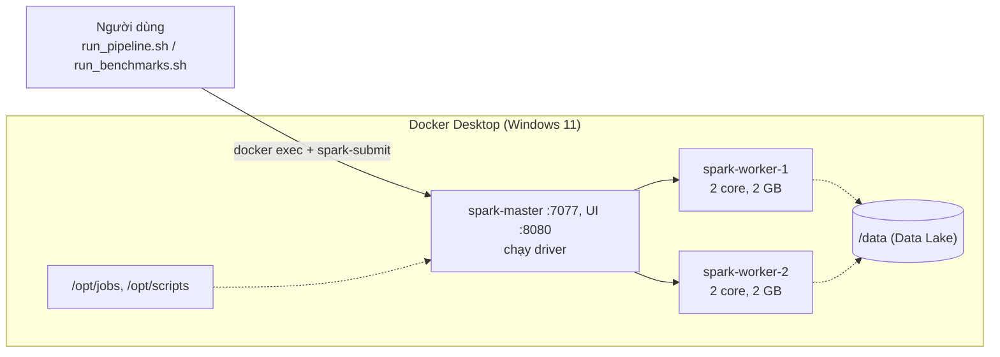
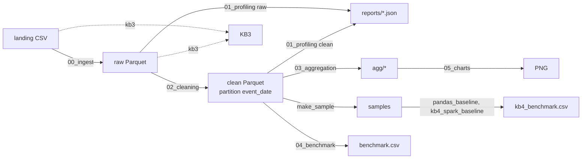

# Chương 4. Thiết kế hệ thống

Chương này mô tả kiến trúc triển khai và luồng dữ liệu của pipeline. Hai sơ đồ nguồn (draw.io) nằm ở
`docs/tv1/diagrams/`: [architecture.drawio](diagrams/architecture.drawio) và [dataflow.drawio](diagrams/dataflow.drawio).
Mở bằng app.diagrams.net (File → Open) hoặc phần mở rộng draw.io của VS Code; khi ghép vào Word thì xuất PNG/SVG từ đó.
Hai sơ đồ Mermaid dưới đây cùng nội dung để xem ngay trên GitHub.

## 4.1 Kiến trúc tổng thể

Hệ thống chạy trên một máy Windows 11 bằng Docker Desktop, gồm ba container Spark dựng bởi `docker-compose.yml`:
một `spark-master` và hai `spark-worker` (mỗi worker 2 core, 2 GB RAM; Master UI cổng 8080, máy TV1 đổi sang 9090 do trùng cổng).
Cả ba dùng chung image `bigdata-spark:3.5.9` (Spark 3.5.9, Java 17, Python 3, cộng pandas, pyarrow, matplotlib theo `Dockerfile`).
Đây là cụm giả lập trên một máy: các worker chia sẻ CPU, RAM và ổ đĩa của máy chủ, nên số đo không phản ánh cụm nhiều máy.

Ba thư mục máy chủ được gắn vào container: `./data → /data` (Data Lake, không đưa lên Git), `./jobs → /opt/jobs`
và `./scripts → /opt/scripts`. Người dùng gọi `scripts/run_pipeline.sh` hoặc `scripts/run_benchmarks.sh` từ Git Bash/PowerShell;
script chạy `docker exec spark-master spark-submit --master spark://spark-master:7077`. Driver chạy trong container master
(`--driver-memory 2g`), các task được giao cho hai worker, và mọi bên đọc/ghi Parquet trên cùng ổ gắn `/data`.

## 4.2 Tổ chức Data Lake

Dữ liệu đi qua bốn tầng, mỗi tầng một thư mục con của `DATA_DIR`. Các job ingest, cleaning, profiling, make_sample từ chối ghi đè
đầu ra đã có (riêng `03_aggregation.py` ghi `overwrite`), nên mỗi lần chạy nên dùng một `DATA_DIR` mới.

| Tầng | Đường dẫn | Định dạng | Do job nào tạo | Nội dung |
|---|---|---|---|---|
| landing | `landing/*.csv` | CSV | đặt tay (Kaggle) | `2019-Oct.csv`, 9 cột, 5.668.612.855 byte |
| raw | `raw/events` | Parquet snappy | `00_ingest.py` | giữ nguyên dữ liệu, schema cố định, không inferSchema |
| clean | `clean/events` | Parquet, phân vùng `event_date` | `02_cleaning.py` | theo [data contract v1.0](../data_contract.md), thời gian UTC |
| agg | `agg/{daily_kpi,category_kpi,brand_kpi,funnel,hourly}` | Parquet | `03_aggregation.py` | KPI cho báo cáo và biểu đồ |

Ngoài ra `samples/frac_<tỷ lệ>` (từ `make_sample.py`) phục vụ KB4 và `reports/` chứa JSON/CSV đo đạc và biểu đồ PNG.

## 4.3 Luồng dữ liệu

Thứ tự chạy của `run_pipeline.sh`:

| Mode | Các bước | Dùng khi |
|---|---|---|
| `--full` | ingest → profiling raw → cleaning → profiling clean → aggregation | chạy toàn bộ |
| `--quality-check` | ingest → profiling raw → cleaning → profiling clean | kiểm tra chất lượng, không tổng hợp |
| `--ingest-clean` | ingest → cleaning | phạm vi tối thiểu |
| `--clean-only` | cleaning từ raw sẵn có | chạy lại cleaning |

Pipeline kiểm tra trước khi chạy (job có đủ không, Docker/Compose, container đang chạy, đầu ra đã tồn tại chưa) và
trả mã lỗi riêng cho từng loại (2 tham số, 3 thiếu job, 4 môi trường/dữ liệu) để biết lỗi nằm ở đâu.
Benchmark (KB1, KB2, KB6) và biểu đồ chạy riêng, không nằm trong `--full`.

## 4.4 Các quyết định thiết kế và lý do

- **Parquet thay CSV từ tầng raw.** Parquet nhỏ hơn và đọc nhanh hơn (KB3: nhỏ hơn 3.869 lần về dung lượng).
- **Schema cố định khi ingest.** `inferSchema` phải quét file hai lần, rất chậm với 5 GB.
- **Phân vùng clean theo `event_date`.** Truy vấn theo ngày chỉ đọc các thư mục cần thiết (xem KB1, biến thể lọc theo ngày).
- **Mỗi lần chạy một `DATA_DIR`, không ghi đè.** Tránh mất dữ liệu cũ và cho phép so sánh các lần chạy.
- **Cụm 2 worker × 2 core trên một máy.** Đủ để quan sát việc phân phối task và đo ảnh hưởng của số core, trong giới hạn máy 8 GB RAM.
- **Chạy cleaning theo lát ngày trên máy 8 GB.** Cleaning nguyên khối 42,4 triệu dòng hết bộ nhớ executor, TV2 chia thành 8 lát
  bằng `slice_raw_by_day.py` rồi gộp (chi tiết ở [Ch.5](../tv3/ch05_trien_khai.md) mục 5.9).

## 4.5 Giới hạn của thiết kế

- Cụm giả lập một máy: không có độ trễ mạng và không kiểm tra được khả năng chịu lỗi nhiều nút.
- Không có hệ thống lưu trữ phân tán (HDFS/S3); Data Lake là một thư mục cục bộ.
- Không có lập lịch hay giám sát tự động; pipeline chạy bằng tay.
- Hai sơ đồ draw.io chưa được xuất thành ảnh trong repo và chưa được mở kiểm tra bằng draw.io; cần mở, chỉnh bố cục nếu cần và xuất khi ghép báo cáo.
