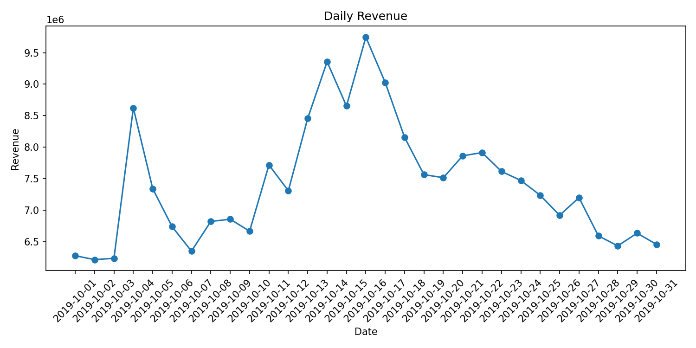
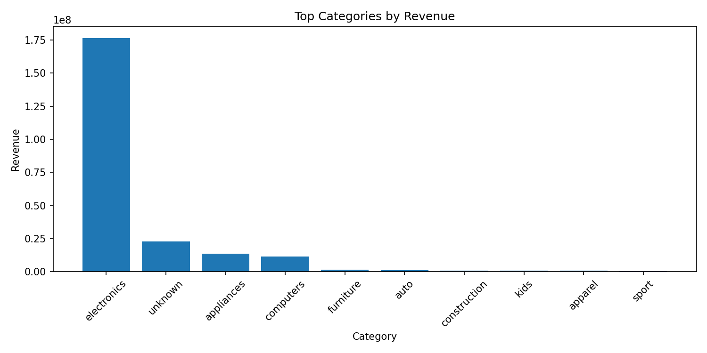
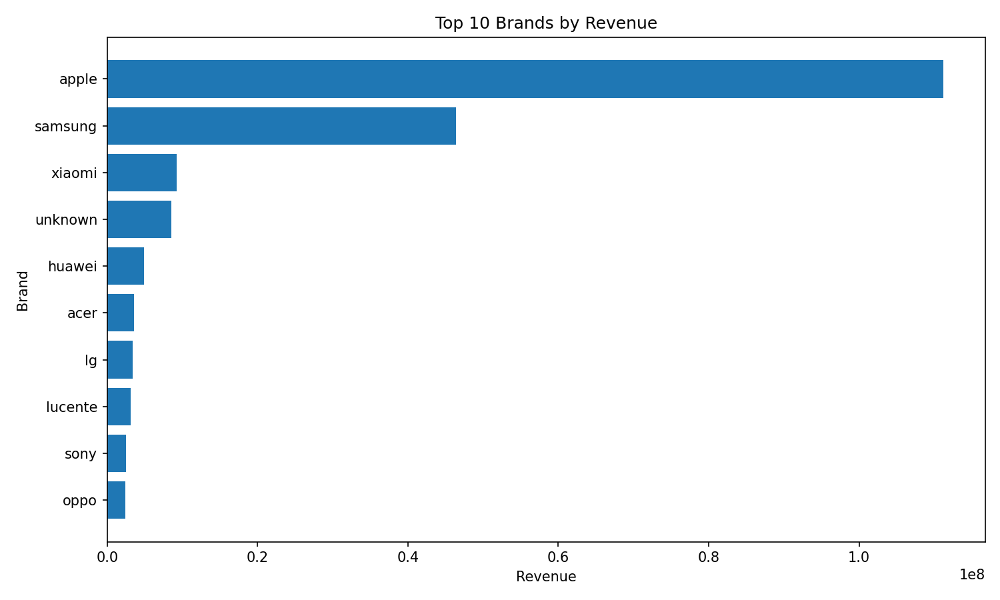
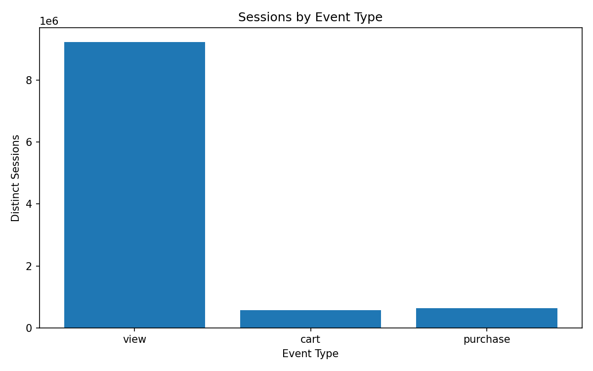
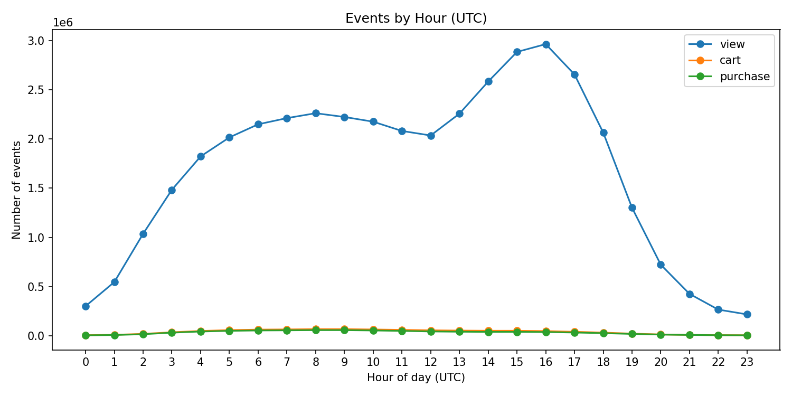

# Chương 7. Kết quả demo

Chương này trình bày kết quả đầu ra của pipeline trên **dữ liệu Kaggle thật** (tháng 10/2019, 42.349.872 dòng clean) và kịch bản demo.
Số liệu lấy từ các bảng `agg/` ở vùng `/data/real_oct_tv4_20261122` và đã được đối chiếu độc lập với clean (mục 7.3: 14/14 kiểm tra đạt).
Mọi con số mô tả hành vi trong **một tháng của một sàn** và chỉ có giá trị mô tả, không suy ra quan hệ nhân quả.

## 7.1 Kết quả chạy pipeline

| Bước | Job | Kết quả trên dữ liệu thật | Nguồn |
|---|---|---|---|
| 1 | `00_ingest.py` | CSV 5.668.612.855 byte → raw Parquet 42.448.764 dòng, khoảng 3,5 phút | `real_cleaning_tv3_result.md`, `kb3.csv` |
| 2 | `02_cleaning.py` (8 lát ngày) | raw 42.448.764 → clean 42.349.872 dòng; mỗi lát 100–150 giây | `real_cleaning_tv3_run_summary.txt` |
| 3 | `03_aggregation.py` | 5 bảng agg, 1 phút 21 giây | mục 7.2 |
| 4 | `check_agg_kpi.py` | 14/14 đạt | `kpi_check.json` |
| 5 | `make_sample.py` | 3 mẫu: 424.672 / 2.118.424 / 4.238.423 dòng | `samples_log.csv` |

## 7.2 Tổng hợp KPI (`03_aggregation.py`) và quy ước không ghi đè

Job đọc `clean/events` và ghi 5 bảng vào `agg/`: `daily_kpi` (31 dòng), `category_kpi` (14 danh mục cấp 1), `brand_kpi` (1.985 thương hiệu),
`funnel` (số phiên khác nhau theo `event_type`) và `hourly` (số sự kiện theo giờ và loại). Doanh thu và số đơn chỉ tính từ `purchase`.
Giá trị `unknown` ở brand và danh mục là nhãn hợp lệ theo contract v1.0, nên xuất hiện như một nhóm riêng. Thời gian là UTC;
`user_session` không phải khóa duy nhất ([bàn giao clean](../tv3/ban_giao_clean_tv4.md)). Lần chạy mất 1 phút 21 giây
(driver 2 GB, cụm 1 master + 2 worker).

**Quy ước không ghi đè.** Bản đầu của job ghi `mode("overwrite")`, khác `00_ingest.py` và `02_cleaning.py`. Đã sửa: job kiểm tra `agg/<bảng>`
trước khi khởi tạo Spark và dừng với `FileExistsError` nếu tồn tại; ghi bằng `errorifexists`. Đã chạy thử lần hai trên cùng `DATA_DIR`:
job dừng, không đổi dữ liệu cũ. Muốn chạy lại phải dùng `DATA_DIR` mới.

## 7.3 Đối chiếu KPI với clean

`scripts/check_agg_kpi.py` tính lại độc lập bằng pandas/numpy từ `clean/events` (đọc từng thư mục ngày, chỉ lấy cột cần, đếm phiên và
người dùng khác nhau bằng hash để vừa bộ nhớ) rồi so từng bảng agg. Bản đầu của script đọc nguyên bảng vào pandas và bị hệ điều hành
kết thúc (exit 137, hết bộ nhớ) với 42 triệu dòng, nên đã viết lại. Kết quả [`kpi_check.json`](../evidence/tv4/real/kpi_check.json):
**14/14 kiểm tra đạt, `all_pass=true`**.

| Chỉ số | Từ clean | Từ agg |
|---|---|---|
| Số ngày (`daily_kpi`) | 31 | 31 |
| Tổng sự kiện (`hourly`) | 42.349.872 | 42.349.872 |
| view / cart / purchase (`daily_kpi`) | 40.708.807 / 898.292 / 742.773 | giống nhau |
| Số đơn (`category_kpi`, `brand_kpi`) | 742.773 | 742.773 |
| Doanh thu (3 bảng) | 229.933.212,63 | 229.933.212,63 |
| Số phiên view / cart / purchase (`funnel`) | 9.237.562 / 573.019 / 629.560 | giống nhau |

Số view/cart khớp với `profiling_clean.json` của TV2 (cart 898.292 sau cleaning). Phép đối chiếu cho thấy bảng agg nhất quán với clean;
nó không kiểm chứng clean đúng so với dữ liệu gốc (việc của TV2/TV3).

## 7.4 Tổng quan KPI tháng 10/2019

| Chỉ số | Giá trị |
|---|---|
| Tổng sự kiện | 42.349.872 (view 96,1%, cart 2,1%, purchase 1,8%) |
| Số đơn (purchase) | 742.773 |
| Doanh thu | 229.933.212,63 |
| Giá trị trung bình mỗi đơn | khoảng 309,6 |
| Người dùng hoạt động mỗi ngày | từ 170.611 (3/10) đến 231.826 (20/10) |

## 7.5 Doanh thu theo ngày



Doanh thu ngày dao động từ 6,21 triệu (2/10) đến 9,75 triệu (16/10). Doanh thu cao hơn rõ rệt trong khoảng 14–17/10 (8,65–9,75 triệu) và đỉnh phụ ngày 4/10
(8,62 triệu); các ngày cuối tháng (28–31/10) về mức 6,4–6,6 triệu. Số `cart` mỗi ngày cũng có hai giai đoạn cao bất thường (khoảng 35.000–48.000
sự kiện vào 4–6/10 và 14–27/10, so với khoảng 16.000–20.000 ở các ngày còn lại) trong khi số view thay đổi ít hơn nhiều. Dữ liệu không cho biết nguyên nhân
(khuyến mãi, thay đổi cách ghi nhận hay yếu tố khác); đây là điểm cần kiểm tra thêm, không phải kết luận.

## 7.6 Doanh thu theo danh mục và thương hiệu



| Danh mục (`cat_l1`) | Số đơn | Doanh thu | Tỷ trọng doanh thu |
|---|---|---|---|
| electronics | 422.979 | 176.445.577,86 | 76,7% |
| unknown | 173.411 | 22.922.165,08 | 10,0% |
| appliances | 74.988 | 13.581.760,58 | 5,9% |
| computers | 27.853 | 11.377.870,82 | 4,9% |

| Thương hiệu | Số đơn | Doanh thu | Tỷ trọng doanh thu |
|---|---|---|---|
| apple | 142.858 | 111.199.495,70 | 48,4% |
| samsung | 172.878 | 46.402.037,35 | 20,2% |
| xiaomi | 56.609 | 9.192.640,24 | 4,0% |
| unknown | 58.210 | 8.539.747,08 | 3,7% |



Điện tử chiếm hơn ba phần tư doanh thu. Apple dẫn đầu doanh thu dù Samsung có nhiều đơn hơn (172.878 so với 142.858), nghĩa là giá trị đơn của Apple cao hơn
đáng kể. Nhóm `unknown` ở danh mục chiếm 23,3% số đơn do `category_code` gốc thiếu; đây là hạn chế của dữ liệu (xem Ch.3), cần đọc cùng các con số trên.

## 7.7 Phễu chuyển đổi



| Loại | Số phiên |
|---|---|
| view | 9.237.562 |
| cart | 573.019 |
| purchase | 629.560 |

Tỷ lệ chuyển đổi purchase/view theo số phiên là **629.560 / 9.237.562 ≈ 6,8%**; cart/view ≈ 6,2%. Số phiên có purchase **lớn hơn** số phiên có cart, nên
phễu không phải chuỗi lồng nhau chặt: nhiều phiên mua hàng không ghi nhận sự kiện cart (ví dụ mua trực tiếp, hoặc phiên bị cắt ở ranh giới tháng). Vì mỗi
cột đếm phiên riêng theo loại nên chỉ nên đọc 6,8% như tỷ lệ gần đúng, không phải xác suất một phiên xem rồi mua.

## 7.8 Hành vi theo giờ

Hoạt động cao nhất lúc 16 giờ UTC (3.048.360 sự kiện), sau đó 15 giờ (2.974.234), 17 giờ (2.727.824) và 14 giờ (2.672.330). Giờ là UTC, chưa quy đổi theo
múi giờ của khách hàng nên không nên gọi là "giờ cao điểm địa phương".



## 7.9 Kết quả KB4 Pandas so với Spark

Kết quả đầy đủ ở Ch.6 mục 6.5. Tóm lại: Pandas nhanh hơn ở 1% (0,72 so với 2,45 s), hai bên gần ngang ở 5% (2,43 so với 2,83 s) và Spark nhanh hơn ở 10%
(3,03 so với 4,42 s); Spark gần như phẳng vì chi phí cố định, Pandas tăng gần tuyến tính.

## 7.10 Kịch bản demo (TV4, khoảng 3 phút)

1. Chạy `03_aggregation.py` trên **mẫu nhỏ hoặc vùng synthetic** (vài giây); mở Spark UI `localhost:4040` tab Jobs/Stages/SQL để thấy các task chạy song song.
2. Chạy lại lần hai để cho thấy job từ chối ghi đè (`FileExistsError`).
3. Mở `daily_kpi`, `category_kpi`, `funnel` bằng `show()`; nêu tỷ lệ chuyển đổi 6,8% và giải thích giới hạn của phễu.
4. Trình chiếu ảnh `daily_revenue.png`, `category_revenue.png` và `pandas_vs_spark.png` từ lần chạy dữ liệu đầy đủ đã lưu (chạy đầy đủ 1 phút 21 giây là ngắn,
   nhưng chuẩn bị ảnh phòng trường hợp cụm chậm).
5. Giải thích KB4 đúng phạm vi: Pandas thắng ở mẫu nhỏ là kết quả bình thường; điểm giao nằm giữa 5% và 10%.

Câu hỏi dễ gặp: *Vì sao Spark chậm ở mẫu nhỏ?* (chi phí khởi tạo và điều phối, lần đầu 5–6 giây); *Doanh thu có đúng không?* (14/14 kiểm tra độc lập đạt);
*`unknown` là gì?* (nhãn thiếu theo contract v1.0, không phải thương hiệu thật).

## 7.11 Thay đổi code và cách chạy lại

- `jobs/03_aggregation.py`: không ghi đè; kiểm tra đầu ra tồn tại trước khi chạy.
- `scripts/check_agg_kpi.py`: đọc theo ngày, đếm distinct bằng hash, chạy được trên 42 triệu dòng.
- `jobs/pandas_baseline.py`, `jobs/kb4_spark_baseline.py`: hai phía KB4 cùng cột `engine,fraction,run,seconds`.
- `jobs/05_charts.py`: đọc `kb4_benchmark.csv` (trước đó đọc nhầm `benchmark.csv` của `04_benchmark.py` khác cột).

```bash
export DATA_DIR=/data/<vung_moi>   # cần clean/events; 03 và make_sample từ chối ghi đè, dùng vùng mới
spark-submit /opt/jobs/03_aggregation.py
python3 /opt/scripts/check_agg_kpi.py
spark-submit /opt/jobs/make_sample.py 0.01 0.05 0.1
for f in 0.01 0.05 0.1; do python3 /opt/jobs/pandas_baseline.py $f 3; spark-submit /opt/jobs/kb4_spark_baseline.py $f 3; done
python3 /opt/jobs/05_charts.py
```

## 7.12 Hạn chế

Chưa có ảnh Spark UI cho `03_aggregation.py`, chưa tập demo trực tiếp và chưa chạy tái lập trên máy khác. Nhận định về nguyên nhân của biến động doanh thu hay số cart chưa được kiểm chứng.

- Chưa chạy KB4 ở 100% dữ liệu và chưa thử Pandas hết RAM.
- Chưa có ảnh Spark UI (`localhost:4040`) cho `03_aggregation.py`; cần chụp khi chạy lại trước buổi demo.
- TV4 chưa tập demo trực tiếp; chưa chạy tái lập trên máy thành viên khác.
