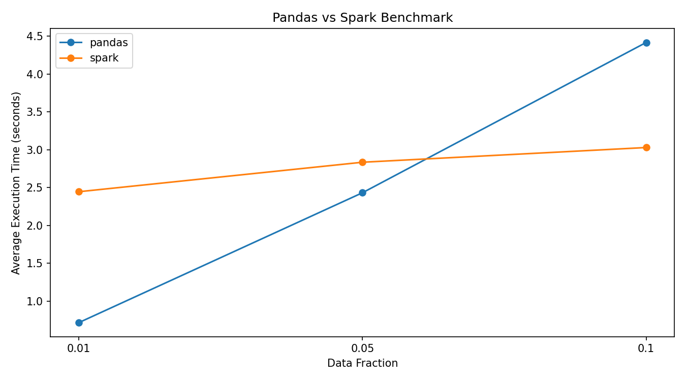

# Chương 6 (phần TV4). Thực nghiệm KB4 – Pandas so với Spark

## 6.5 KB4 – Pandas so với Spark

> Số liệu trong chương này chạy ngày 22/11/2026 trên **dữ liệu Kaggle thật** (`2019-Oct.csv`, tầng clean 42.349.872 dòng, 31 ngày).
> Vùng chạy `DATA_DIR=/data/real_oct_tv4_20261122` (không đưa lên Git) gồm bản sao 8 lát clean `tv3_real_s1..s8` do TV3 tự chạy ngày 22/11
> (khớp tổng 42.349.872 của TV2). Phần tổng hợp KPI và đối chiếu ở Ch.7 (mục 7.2–7.3). Minh chứng nằm ở [`docs/evidence/tv4/real/`](../evidence/tv4/real/). Kết quả cũ trên synthetic
> (19.627 dòng) đã bỏ khỏi thư mục minh chứng (còn trong lịch sử Git) và **không dùng** trong báo cáo.

### 6.5.1 Cách đo

Cùng phép tính ở hai phía: đọc `samples/frac_<tỷ lệ>`, `groupby(event_date, event_type)` tính count và sum(price), ghi thời gian
gồm cả bước đọc Parquet, **3 lần lặp** mỗi cấu hình. Mẫu do `jobs/make_sample.py` cắt từ clean thật (seed 42, 1 file Parquet). Pandas chạy trong
container `spark-master` (`jobs/pandas_baseline.py`, 1 tiến trình, không giới hạn RAM riêng ngoài 7,6 GiB của Docker); Spark là cụm 1 master + 2 worker
(2 core, 2 GB mỗi worker), driver 2 GB (`jobs/kb4_spark_baseline.py`). Máy: Windows 11, 20 CPU logic, Docker được cấp khoảng 7,6 GiB RAM.
Dữ liệu thô: [`kb4_benchmark.csv`](../evidence/tv4/real/kb4_benchmark.csv).

### 6.5.2 Kết quả

| Tỷ lệ mẫu | Số dòng | Pandas TB (s) | Spark TB, 3 lần (s) | Spark TB, bỏ lần 1 (s) |
|---|---|---|---|---|
| 0,01 | 424.672 | 0,717 | 2,445 | 0,943 |
| 0,05 | 2.118.424 | 2,432 | 2,834 | 1,270 |
| 0,10 | 4.238.423 | 4,415 | 3,028 | 1,584 |

### 6.5.3 Diễn giải

 Pandas tăng gần tuyến tính theo số dòng (0,72 → 2,43 → 4,42 s khi dữ liệu tăng 5× rồi 2×) vì xử lý trên một tiến trình;
Spark gần như phẳng (2,4 → 3,0 s) vì chi phí cố định lên lịch job và shuffle chiếm phần lớn. Ở 1% Pandas nhanh hơn 3,4 lần; ở 5% Pandas vẫn nhanh hơn
(2,43 so với 2,83 s); ở 10% Spark nhanh hơn 1,5 lần (3,03 so với 4,42 s). Điểm giao nằm giữa 5% và 10% (khoảng 2–4 triệu dòng) với
số liệu trung bình. Lần Spark đầu tiên của mỗi cấu hình luôn chậm (5,4–6,0 s, khởi tạo ứng dụng và đọc metadata); nếu bỏ lần này,
Spark đã nhanh hơn Pandas từ 5%. Hai cách tính cho cùng kết luận định tính: Pandas thắng ở mẫu rất nhỏ, Spark thắng khi dữ liệu đủ lớn.

### 6.5.4 Giới hạn

 Chỉ 3 lần mỗi cấu hình, chưa kiểm định thống kê; cụm Spark chạy trên cùng một máy với Pandas nên hai bên tranh chấp tài nguyên và không có
độ trễ mạng; chưa xóa cache hệ điều hành giữa các lần. Pandas **chưa hết bộ nhớ** ở 10% (4,2 triệu dòng); kỳ vọng "Pandas hết RAM ở dữ liệu lớn" của đề
chưa được thử ở 100% (42 triệu dòng) vì thực nghiệm chỉ theo phạm vi 1–10%. Điều đã thấy ở 100% là bước kiểm KPI bằng pandas nguyên bảng bị kết thúc vì hết bộ nhớ (mục 7.3),
tức là chỉ gián tiếp ủng hộ lập luận này trên bảng nhiều cột.

**Đối chiếu chéo.** Một lần chạy độc lập khác trên vùng `/data/real_oct_full` ([`run_real_oct_full/`](../evidence/tv4/real/run_real_oct_full/)) cũng cho KPI 14/14 và cùng xu hướng KB4: Pandas trung bình 0,59 / 1,85 / 4,08 s, Spark 3,53 / 3,79 / 3,84 s ở 1% / 5% / 10%. Ở lần này Spark chỉ nhỉnh hơn Pandas ở 10% (3,84 so với 4,08 s), nên điểm giao nằm gần 10%; khác biệt giữa hai lần chạy cho thấy ngưỡng giao phụ thuộc vào lần đo và chỉ nên nêu là khoảng 5–10%.
